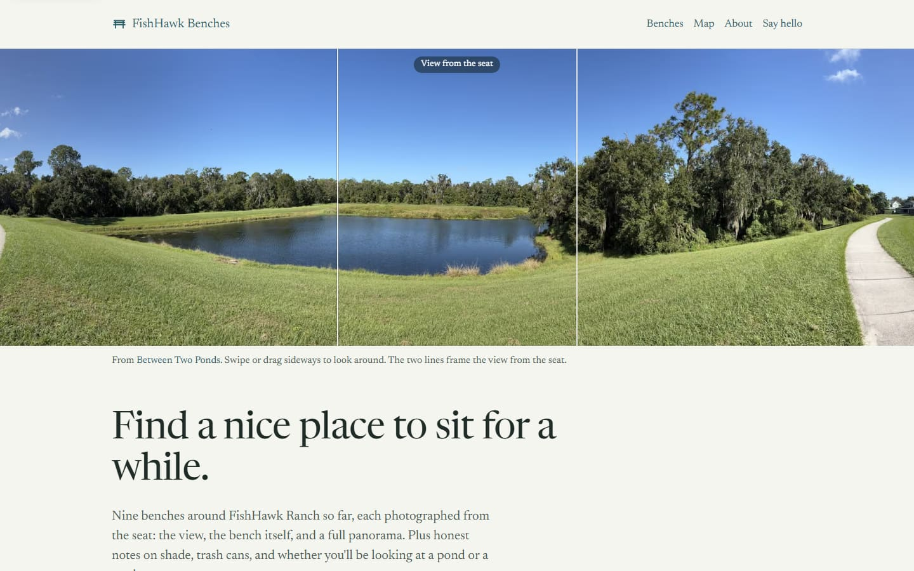
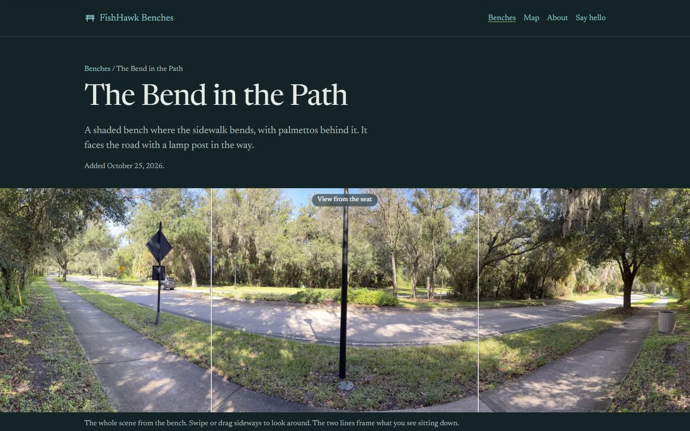
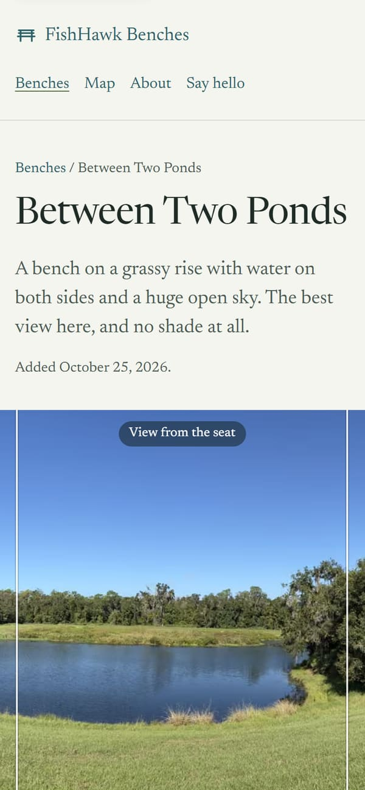
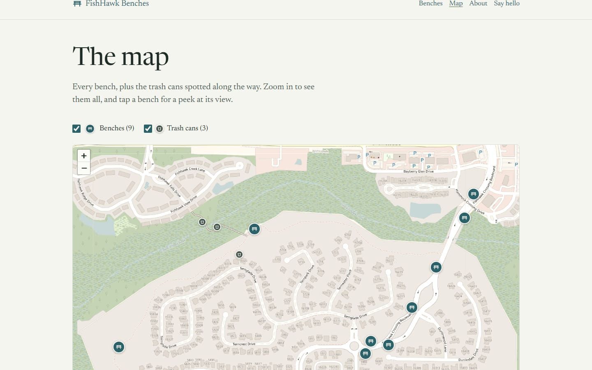

# FishHawk Benches

A guide to the public benches of FishHawk Ranch: the view from each seat, a panorama, pros and
cons, sunrise/sunset times, and a map with every bench and trash can.

**Live:** https://fishhawk-benches.vercel.app



| Bench page | Phone | Map |
|---|---|---|
|  |  |  |

## Features

- View-from-the-seat photo, framed inside a swipeable panorama (found by image matching), with an
  overview strip to jump around on phones
- "Start here" picks (best view, most shade, sunsets) chosen by rules from the data
- Pros and cons generated from the same rules for every bench
- Sunrise/sunset notes from the photo's compass heading and the sun's path through the year
- Map of benches and trash cans (Leaflet + OpenStreetMap)
- Photo import that groups phone photos by GPS and time and strips their location metadata

## Stack

Next.js 16, TypeScript, Tailwind CSS 4, Leaflet, zod-validated Markdown content, Vitest,
Playwright. Fully prerendered; no database, cookies or analytics.

## Run locally

Requires Node.js 20.9+.

```bash
npm install
cp .env.example .env.local
npm run dev
```

| Command | |
|---|---|
| `npm run check` | lint, types, content validation, unit tests, build |
| `npm run test:e2e` | browser + accessibility tests (after `npm run build`) |
| `npm run ingest` | import new bench photos |

## Docs

- [Adding benches](docs/adding-benches.md)
- [Deploying](docs/deploying.md)
- [Legal review notes](LEGAL-REVIEW.md)

Map screenshots © [OpenStreetMap](https://www.openstreetmap.org/copyright) contributors.
