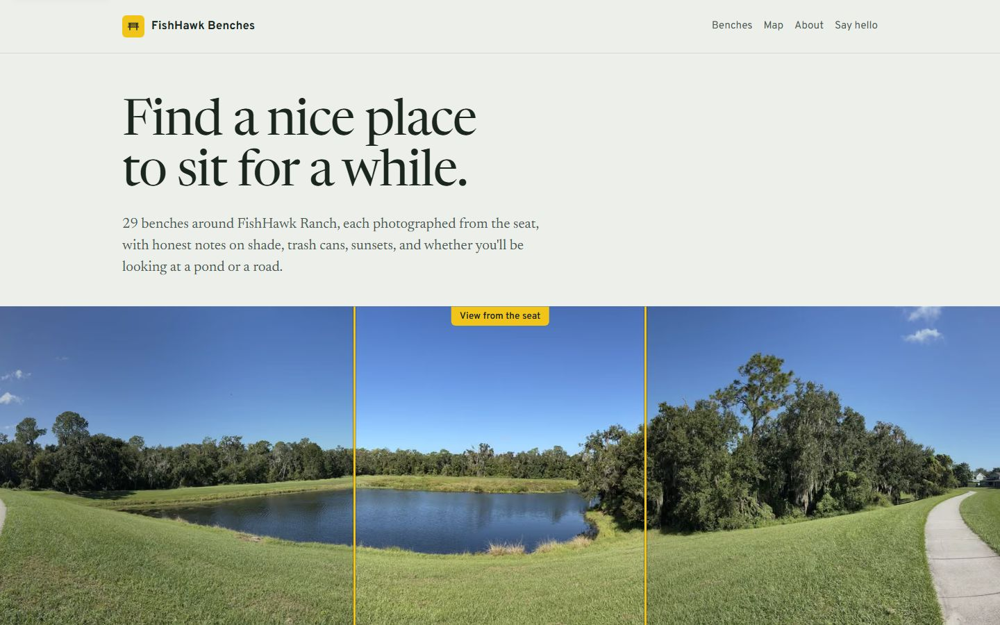
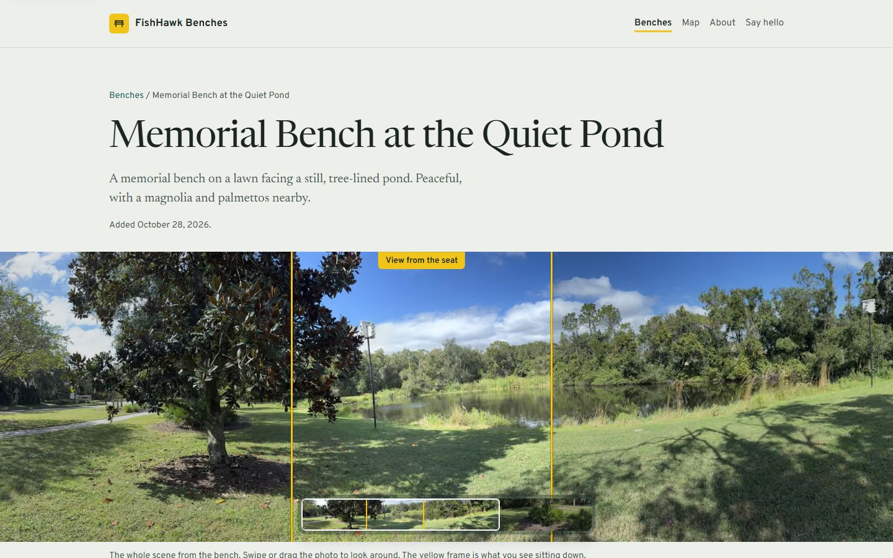
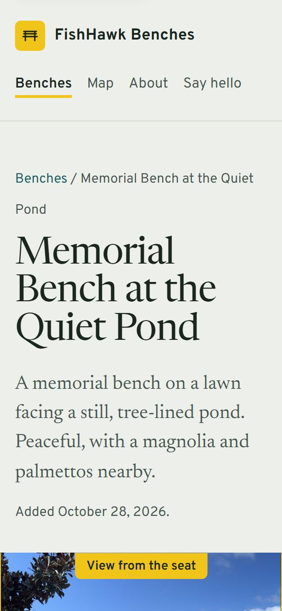
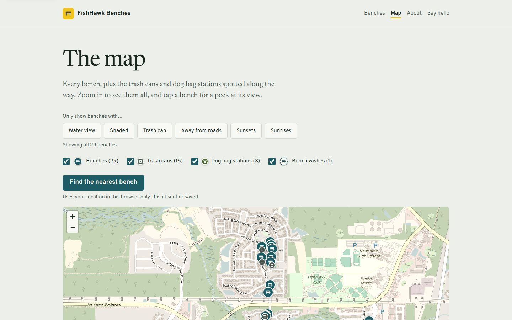

# FishHawk Benches

A guide to the public benches of FishHawk Ranch: the view from each seat, a panorama, pros and
cons, sunrise/sunset times, and a map with every bench, trash can and dog bag station.

**Live:** https://fishhawk-benches.vercel.app



| Bench page | Phone | Map |
|---|---|---|
|  |  |  |

## Features

- View-from-the-seat photo, framed in yellow inside a swipeable panorama, with an overview strip
  for jumping around on phones
- "Start here" picks and pros/cons generated by rules from each bench's data
- Sunrise/sunset notes from the photo's compass heading and the sun's path through the year
- Map with filters, "Find the nearest bench" (location stays on the device) and bench wishes
- "Recently added" on the home page, per-bench link previews, RSS feed
- Works offline for pages you've already opened (service worker), installable to a home screen
- Contact form that emails you through Resend
- Photo import that groups phone photos by GPS and time and strips their location metadata

## Stack

Next.js 16 (App Router, every page prerendered), TypeScript, Tailwind CSS 4, Leaflet with
OpenStreetMap tiles, zod-validated Markdown content, Vitest, Playwright with axe. No database,
cookies, analytics or accounts.

## How it's put together

```
content/
  benches/*.md          one bench per file: YAML frontmatter + Markdown notes
  trash-cans.json       map-only trash cans and dog bag stations
  bench-wishes.json     spots that need a bench (dashed pins)
public/
  photos/<slug>/        web JPEGs, all metadata stripped (checked by `npm run validate`)
  sw.js                 offline service worker
src/
  app/                  pages (App Router), metadata, sitemap, robots, feed, share images
    contact/            the form and its Server Action
  components/           panorama, map, bench listings, header/footer
  lib/content/          schema.ts (zod) → parse.ts → load.ts (reads files) → traits.ts (pros/cons rules)
  lib/contact/          validation, rate limit, Resend mailer (server-only)
  lib/share-image.tsx   link-preview image renderer
scripts/                ingest (photo import), validate, locate-views, placeholders
tests/                  unit/ (Vitest) and e2e/ (Playwright + axe)
```

Content in `content/` is treated as untrusted: it's validated against strict schemas and rendered
as plain Markdown, never as raw HTML.

## Design system

All tokens live in [`src/app/globals.css`](src/app/globals.css) as CSS variables, exposed to
Tailwind as `bg-paper`, `text-ink`, `border-rule` and so on. Dark mode follows the reader's
system setting by redefining the same variables.

| Token | Light | Dark | Used for |
|---|---|---|---|
| `paper` | `#edf0ea` | `#142326` | Page background |
| `paper-raised` | `#f8f9f5` | `#1a2d31` | Footer, inputs, chips, popups |
| `ink` | `#1b2621` | `#e5ebe5` | Text |
| `ink-soft` | `#4a5751` | `#aebcb5` | Secondary text, small print |
| `pond` / `pond-deep` | `#1d5c64` / `#14434a` | `#8fc6cc` / `#b4dde1` | Links, main buttons |
| `moss` | `#4e6b34` | `#a9c48f` | Pick labels, "pros" icons |
| `reed` | `#e2dac0` | `#3a3d2c` | Photo and map backgrounds while loading |
| `rule` | `#d3d9cf` | `#2c4145` | Borders and dividers |
| `blaze` | `#f0c419` | `#f0c419` | Only "where you are / where you'd look": seat-view frame, active pin, you-are-here, current nav item, alligator caution |
| `danger` | `#9b3b2f` | `#f0b2a6` | Form errors only |

**Type.** Two families, both self-hosted by `next/font`:

- **Newsreader** (serif) for headings and reading text. Display headings use `.display`, intro
  paragraphs use `.lede`.
- **Overpass** (based on US road-sign lettering) for anything you tap or scan: buttons, labels,
  facts, captions. Use `font-sans`, `.meta` for small print (0.9rem), `.sign` for named labels,
  and `text-ui` (0.95rem) or `text-ui-lg` (1.05rem) for controls.

Sentence case everywhere. No all-caps labels.

**Shape and spacing.** Controls (buttons, chips, inputs) use `rounded-md`. Photos and panels use
`rounded-lg`. Content sits in `.frame` (max 72rem, 1rem side padding, 2rem from 640px). Every
tap target is at least 44px tall (`min-h-11`).

**States.** Links underline thicker on hover. Every focusable element gets a 3px `focus`
outline. Buttons move 1px down when pressed and show a not-allowed cursor when disabled.
Selected chips and the current page turn solid ink.

## Run it locally

Requires Node.js 20.9 or newer.

```bash
npm install
cp .env.example .env.local
npm run dev
```

Open http://localhost:3000. The contact form only sends mail once the Resend variables are set.
Until then it says it isn't set up.

| Command | What it does |
|---|---|
| `npm run dev` | Development server |
| `npm run check` | Lint, types, content validation, unit tests, production build |
| `npm run test:e2e` | Browser, accessibility (light and dark) and offline tests. Run `npm run build` first. |
| `npm run ingest` | Import new bench photos ([guide](docs/adding-benches.md)) |
| `npm run validate` | Check content and photo metadata only |
| `npm run audit` | Check production dependencies for known vulnerabilities |

## Testing & Verification

Run these before every deploy. Each must finish with exit code 0.

```bash
npm run check        # lint, typecheck, content validation, unit tests, production build
npm run test:e2e     # browser tests against that build (run `npm run check` or `npm run build` first)
npm run audit        # known vulnerabilities in production dependencies
```

To run one step on its own:

| Command | What it checks |
|---|---|
| `npm run lint` | ESLint (Next.js rules). Add `-- --max-warnings=0` to fail on warnings too. |
| `npm run typecheck` | TypeScript, including generated route types |
| `npm run validate` | Bench files, photos and their metadata. "Within 10 m" lines are hints about benches that sit close together, not errors. |
| `npm test` | Unit tests (Vitest, `tests/unit/`): content rules, contact form validation and spam checks, sun and map maths, and the loading, error and 404 screens |
| `npm run build` | Production build. Every page should be listed as prerendered. |
| `npm run test:e2e` | Browser tests (Playwright, `tests/e2e/`) in desktop Chrome and a Pixel 7 |

The browser tests cover:

- Every page renders with one heading, a unique title and no console errors
- No sideways scrolling at 375px, 412px, 1280px and 1440px
- Accessibility (axe, WCAG 2.2 AA) in light and dark mode, plus a check that every control has
  an accessible name at phone and desktop widths
- User paths: home → bench → bench list → map, tag links, header links and the 404 page's links
- The map: filters, toggles, "Find the nearest bench" (found, far away, and no answer)
- The contact form: empty fields, a bad email, a too-short message, the sending state, success,
  and keeping what you typed after an error
- Offline reading, share images, RSS, the sitemap, security headers and photo metadata
- A performance budget for script size, largest paint and layout shift

Useful options: `npx playwright test -g "contact form"` runs matching tests only,
`--project=desktop` skips the phone run. When a test fails, its trace is saved under
`test-results/`; open it with `npx playwright show-trace <path to trace.zip>` to step through
what the browser saw.

## Environment variables

Copy [`.env.example`](.env.example) to `.env.local` for local work. In production, set them in
Vercel → Settings → Environment Variables. Never commit real values, and never give a secret a
`NEXT_PUBLIC_` name, because those are sent to browsers.

```bash
# Optional on Vercel (defaults to the production domain). Must be https elsewhere.
NEXT_PUBLIC_SITE_URL=http://localhost:3000

# Contact form (server-only)
RESEND_API_KEY=            # sending-only key from resend.com
CONTACT_TO_EMAIL=          # your inbox; without a verified domain it must be the Resend account email
CONTACT_FROM_EMAIL=        # e.g. "FishHawk Benches <onboarding@resend.dev>"

# Optional
CONTACT_DELIVERY=resend    # or "log" to print messages instead of sending (local only)
# CONTACT_RATE_LIMIT=5     # messages per visitor per 15 minutes
# SHOW_DRAFTS=true         # show draft benches in `npm run dev`
```

## Deploying

The site is on Vercel, linked to this GitHub repo.

1. Run `npm run check` and `npm run test:e2e` locally. Both should pass.
2. Commit and push to `main`. Vercel builds and publishes production automatically. Other
   branches get preview URLs.
3. Check the live site once the deployment shows **Ready** in Vercel (or `vercel ls`).

To roll back, open Vercel → Deployments, pick the last good one and choose **Promote to
Production**, or `git revert <commit>` and push. Custom domains, the contact form's limits and
other details are in [docs/deploying.md](docs/deploying.md).

## Keeping it healthy

- Run `npm run audit` now and then, and update Next.js when it reports advisories
  (`npm install next@<version> eslint-config-next@<version>`, then the checks above).
- Any new third-party service (fonts, scripts, APIs) needs a line in the privacy page and the
  Content-Security-Policy in `next.config.ts`.
- Photos in `public/photos/` are kept at about 2000px wide; pages serve resized copies through
  `next/image`.

## Docs

- [Adding benches](docs/adding-benches.md)
- [Deploying](docs/deploying.md)
- [Legal review notes](LEGAL-REVIEW.md)

Map screenshots © [OpenStreetMap](https://www.openstreetmap.org/copyright) contributors.
